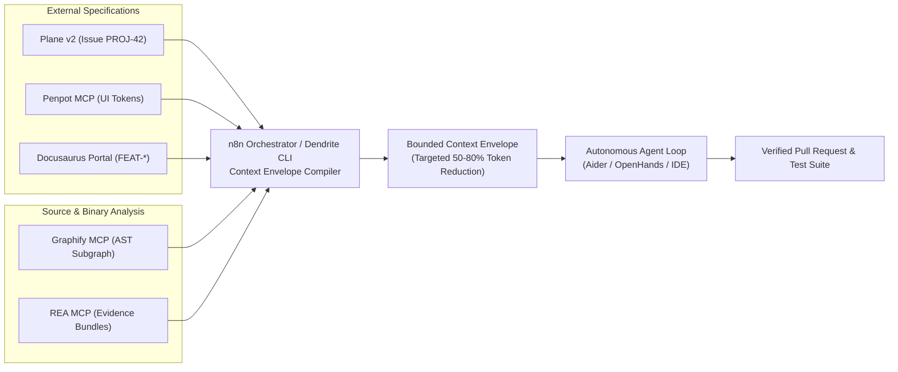
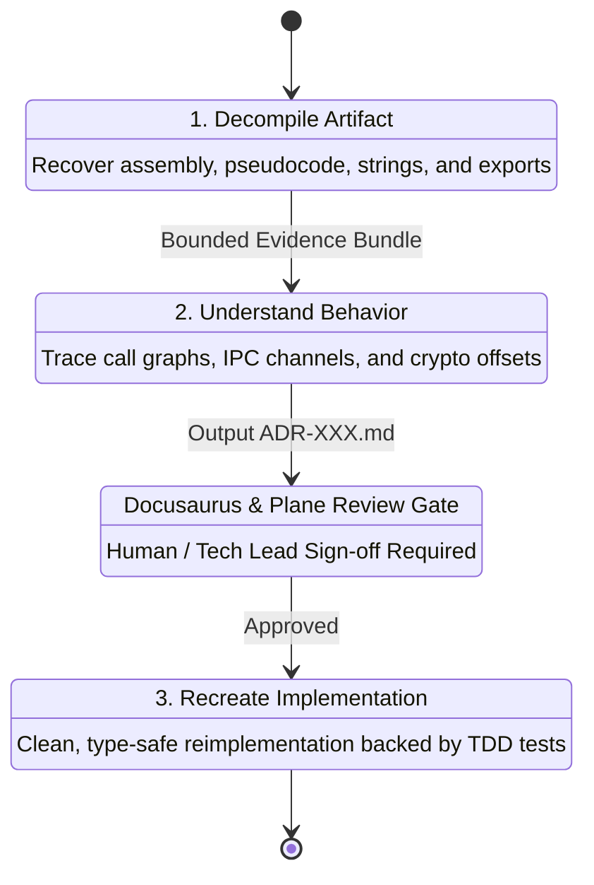

<!-- Imported from Dendrite docs/architecture/03-context-intelligence-re.md @ 69ea048 on 2026-10-18. Source of truth for this repo's scope; keep in sync with the Dendrite copy until the extraction umbrella lands. -->

---
id: 03-context-intelligence-re
title: "Context Intelligence & REA Reverse Engineering Architecture"
sidebar_label: "03: Context Intelligence & REA"
sidebar_position: 3
tags: [architecture, rea, context-intelligence, ast]
---

# Context Intelligence & REA Reverse Engineering Architecture

## 1. Context Engineering vs. Monolithic Context Dumps

Indiscriminately injecting entire codebases or disassembled assembly dumps into an LLM context window causes:
1. **Severe Token Bloat & Cost Inflation**: Consumes tens of thousands of tokens per prompt cycle.
2. **Context Dilution & Attention Degradation**: Frontier models suffer from the "lost in the middle" phenomenon when relevant facts are buried in megabytes of source files.
3. **Hallucination Risk**: Unbounded code fragments confuse the model regarding dependencies, types, and architectural invariants.

Dendrite implements **Precision Context Engineering** by uniting:
- **Graphify MCP**: Graph-based AST symbol blast-radius querying.
- **Penpot MCP**: Machine-readable UI design tokens.
- **Docusaurus Docs-as-Code**: Durable architectural specifications (`FEAT-*`) and decision records (`ADR-*`).
- **REA (Reverse Engineer Anything)**: Bounded evidence bundles for binary analysis.



---

## 2. Codebase Intelligence via Graphify MCP

Graphify builds an offline, persistent structural knowledge graph of software repositories without relying on third-party cloud indexing:
- **Tree-sitter Parsing**: Extracts exact Abstract Syntax Trees (ASTs) for Go, Rust, TypeScript, Python, and C/C++.
- **Leiden Community Detection**: Clusters functions, classes, modules, and interfaces into cohesive topological modules.
- **Local Persistence**: Stores nodes, edges, caller/callee relationships, and symbol definitions in an offline SQLite database (`graphify.db`).
- **MCP Primitives**: Agents query caller/callee structures, symbol blast radius, and dependency graphs instead of executing grep over disk files.

---

## 3. UI Token Alignment via Penpot MCP

Frontend and client-side changes require strict alignment with visual specifications to prevent UI drift:
- Penpot MCP connects directly to project design workspaces.
- Exposes layout properties, typography scales, color palettes, spacing variables, and component hierarchies as typed JSON schemas.
- Agents synthesize frontend code using exact design tokens rather than guessing CSS properties.

---

## 4. Docs-as-Code Synchronization via Docusaurus

Architectural decisions and technical feature contracts are stored as version-controlled Markdown in `docs/`:
- **`FEAT-*` (Feature Specifications)**: Define business goals, acceptance criteria, and technical boundaries.
- **`ADR-*` (Architecture Decision Records)**: Document structural choices, algorithm reconstructions, and trade-offs.

### Mandatory YAML Frontmatter Schema
```yaml
---
id: FEAT-CORE-042
title: Asynchronous Event Dispatcher
status: approved
plane_epic: PROJ-E-12
dependencies:
  - FEAT-AUTH-001
repository: backend-service
tags: [core, messaging, async]
---
```

---

## 5. Binary & Application Reverse Engineering Suite (REA)

For inspecting third-party libraries, compiled legacy binaries, Mach-O executables, and packaged Electron/JavaScript applications, Dendrite integrates **REA ("Reverse Engineer Anything" — [rea.tools](https://rea.tools))**.

### The 3-Stage REA Engineering Protocol



1. **Decompile**: Inspects binaries (Mach-O, ELF, PE, Electron ASAR, `.app` bundles) via Hopper or Ghidra, recovering disassembly, pseudocode, and symbol bindings.
2. **Understand**: Follows call graphs, traces inter-process communications (IPC), isolates algorithms and data structures.
3. **Recreate**: Synthesizes clean, safe code with automated tests derived from observed binary behavior.

### Dual-Target REA Deployment Strategy

1. **Native macOS Workstation Node**:
   - Installed via `npx -y rea-agents@latest setup`.
   - Pairs with Hopper Disassembler and local Ghidra bindings.
   - Ideal for Apple Silicon Mach-O binaries, Swift/Objective-C frameworks, Chrome DevTools Protocol, and sensitive proprietary software that cannot leave the workstation.
2. **Containerized Linux RE Worker (`stack-rea-linux`)**:
   - Deployed on Debian or Azure VM.
   - Bundles Headless Ghidra (`analyzeHeadless`), Rizin/Radare2, and Binwalk.
   - Hardened with `cap_drop: [ALL]`, `read_only: true`, and isolated network namespaces for dissecting untrusted or malware-adjacent Linux ELF and Windows PE binaries.

### REA Governance & Context Boundary Contract
To prevent token waste, REA returns **bounded evidence bundles** (focused functions, cross-references, or isolated IPC schemas) rather than full disassembly listings. Agents are strictly prohibited from modifying application source code directly following decompilation; they must first draft an `ADR-XXX.md` in Docusaurus and request sign-off.
