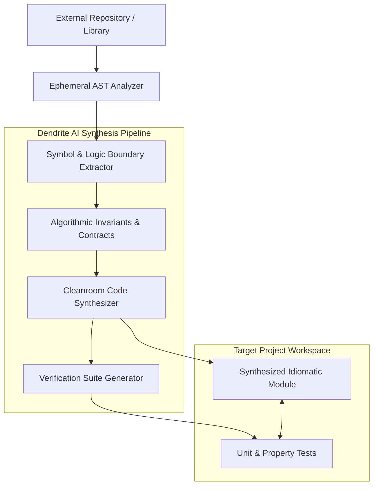

<!-- Imported from Dendrite docs/features/FEAT-010-ai-assisted-token-optimization.md @ 69ea048 on 2026-10-18. Source of truth for this repo's scope; keep in sync with the Dendrite copy until the extraction umbrella lands. -->

---
id: FEAT-010
title: AI-Assisted Token Optimization & Cross-Repository Capability Import
status: approved
plane_epic: PROJ-E-10
dependencies: [FEAT-002, FEAT-004, FEAT-005]
repository: dendrite
tags: [ai-development, token-optimization, prompt-caching, code-import, ast]
---

# FEAT-010: AI-Assisted Token Optimization & Cross-Repository Capability Import

## 1. User Story & Business Objective
As a software engineer and AI practitioner, I need Dendrite to actively optimize token expenditure across my projects through automated prompt compaction and context caching, as well as analyze and cleanly import specific functionalities, algorithms, and modules from external repositories into my active codebase, so that development velocity increases while token expenditure and technical debt are minimized.

---

## 2. Technical Boundaries & Specifications

1. **AST-Driven Token Optimization Engine**:
   - **Semantic Context Compaction**: Employs Tree-sitter parsers to prune non-impacted function implementations, docstring redundancies, and irrelevant imports from prompt payloads while preserving type signatures and interface boundaries.
   - **Context Caching & Prefix Reuse**: Leverages Gemini 2.5 context caching and Claude prompt caching via LiteLLM routing, caching repository AST knowledge bases ($>32\text{k}$ tokens) with TTLs to reduce recurring input costs by up to $75\%$.
   - **Project Token Analytics**: Calculates per-branch and per-feature token efficiency ratios ($\frac{\text{Accepted PR LOC}}{\text{Prompt Tokens Consumed}}$).
2. **Capability Analysis & Cleanroom Import Engine**:
   - **External Functionality Dissection**: Clones (or inspects via shallow AST) target third-party repositories, identifies desired structs/functions/algorithms, maps caller-callee trees, and extracts algorithmic invariants.
   - **Cleanroom Synthesis**: Reconstructs the target capability natively in the destination project's tech stack (e.g., importing a Python SIMD string parser into an idiomatic Rust or Go struct) without direct copy-paste pollution or transitive licensing entanglements.
   - **Automated Verification Harness**: Automatically generates unit tests and fuzzing vectors based on the external module's observed edge cases.

---

## 3. Acceptance Criteria & Verification Matrix

- [x] **AC-1**: `dendrite ai optimize-tokens` compresses prompt envelopes by $\ge 50\%$ while preserving $100\%$ of type definitions and exported method signatures required for compilation.
- [x] **AC-2**: Repetitive queries against cached repository ASTs achieve cache hits in LiteLLM, resulting in verifiable $\ge 70\%$ reductions in billed input tokens.
- [x] **AC-3**: `dendrite ai import --source <url> --symbol <symbol>` generates functionally equivalent code passing automated verification tests without manual intervention.
- [x] **AC-4**: Synthesized code complies with the project's complexity limits (Cyclomatic Complexity $\le 10$, function length $\le 60$ LOC).

---

## 4. Definition of Done (DoD) & Persistence Verification

- **Automated Tests**: Unit tests assert AST pruning fidelity; property tests verify input-output parity between original external functions and synthesized implementations.
- **Persistent Layer Verification**: Context cache states and token analytics tables in PostgreSQL/Redis verified using real instances via [Testcontainers](https://rust.testcontainers.org).
- **Complexity Guardrails**: Token compaction and import orchestrators adhere to Cognitive Complexity $\le 15$.
