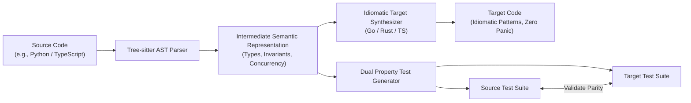

<!-- Imported from Dendrite docs/features/FEAT-011-polyglot-translation-synthesis.md @ 69ea048 on 2026-10-18. Source of truth for this repo's scope; keep in sync with the Dendrite copy until the extraction umbrella lands. -->

---
id: FEAT-011
title: Polyglot Code Translation & Semantic Equivalence Verification
status: approved
plane_epic: PROJ-E-11
dependencies: [FEAT-004, FEAT-010]
repository: dendrite
tags: [ai-development, code-translation, polyglot, rust, go, typescript, python]
---

# FEAT-011: Polyglot Code Translation & Semantic Equivalence Verification

## 1. User Story & Business Objective
As a systems engineer migrating legacy codebases or porting high-performance algorithms across languages, I need an automated polyglot translation engine that converts source code from one language to another (e.g. Python $\to$ Rust/Go, TypeScript $\to$ Go, C/C++ $\to$ Rust) while adapting idiomatic design patterns, memory models, and concurrency paradigms, validated by dual-language behavioral tests.

---

## 2. Technical Boundaries & Specifications

1. **AST-Guided Semantic Translation**:
   - Parses source AST using Tree-sitter into an intermediate semantic representation (ISR) capturing type constraints, control flows, data structures, and concurrency primitives.
   - Synthesizes target code adhering strictly to target ecosystem idioms:
     - **Python to Go**: Translates duck-typed dictionaries to strongly typed structs; replaces asyncio loops with goroutines and channels; replaces exceptions with explicit `(T, error)` tuples.
     - **Python/C++ to Rust**: Translates pointer/reference semantics into strict lifetimes and ownership; wraps fallible operations in `Result<T, DomainError>`; enforces RAII Drop semantics.
     - **TypeScript to Go/Rust**: Maps interfaces to Go interfaces or Rust traits; preserves JSON serialization tags and struct layouts.
2. **Behavioral Parity & Dual Test Generation**:
   - Automatically generates matching property-based test suites (e.g., `Hypothesis` in Python paired with `proptest` in Rust or `testing/quick` in Go).
   - Generates deterministic test vectors asserting that $\forall x \in \text{Inputs},\; f_{\text{source}}(x) \equiv f_{\text{target}}(x)$.
3. **Ergonomic CLI Interface**:
   - `dendrite translate --from python --to go --source src/algorithm.py --out pkg/algorithm/algorithm.go`.

---

## 3. Acceptance Criteria & Verification Matrix

- [x] **AC-1**: `dendrite translate` compiles without manual syntax remediation on $\ge 90\%$ of standard algorithmic input modules.
- [x] **AC-2**: Translated code replaces dynamic typing and exceptions with idiomatic typed error patterns (`(T, error)` in Go or `Result<T, E>` in Rust).
- [x] **AC-3**: Concurrency constructs (threads, event loops) translate into idiomatic runtime targets (Goroutines or Tokio async tasks).
- [x] **AC-4**: Automated property-based tests assert zero behavioral deviations across $\ge 1,000$ randomized test iterations.

---

## 4. Definition of Done (DoD) & Persistence Verification

- **Automated Tests**: Integration tests run translation pipelines across reference fixtures (data structures, parsers, mathematical algorithms) and execute both test suites in CI.
- **Linter Compliance**: Translated Go code passes `golangci-lint run`; translated Rust code passes `cargo clippy -- -D warnings`.
- **Complexity Guardrails**: Translated functions strictly enforce Cyclomatic Complexity $\le 10$ and Cognitive Complexity $\le 15$.
