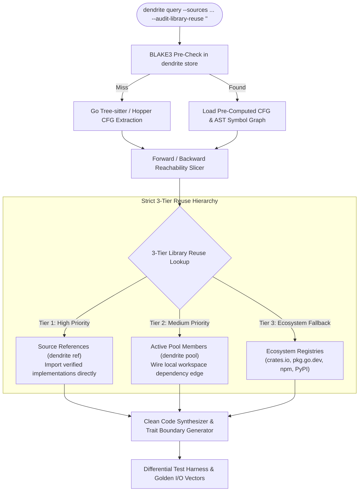

<!-- Imported from Dendrite docs/features/FEAT-030-universal-query-engine-3tier-library-reuse.md @ 69ea048 on 2026-10-18. Source of truth for this repo's scope; keep in sync with the Dendrite copy until the extraction umbrella lands. -->

---
id: FEAT-030
title: "Universal Intent & Query Engine with Strict 3-Tier Library Reuse Auditor"
status: approved
plane_epic: PROJ-E-15
dependencies: [FEAT-003, FEAT-004, FEAT-010, FEAT-011, FEAT-026]
repository: dendrite
tags: [dendrite-query, cfg-slicing, subsystem-swap, safe-rust, 3-tier-reuse, golden-vectors]
---

# FEAT-030: Universal Intent & Query Engine with Strict 3-Tier Library Reuse Auditor

## 1. Executive Summary & Problem Statement

### The Problem
Engineers modernizing legacy binaries and sprawling repositories are forced into all-or-nothing re-writes or manual decompilation guesswork. When developers extract algorithms, swap legacy rendering pipelines (OpenGL/DirectX to `wgpu` or Three.js), or transpile systems to safe Rust, they frequently reinvent library boilerplate (linear algebra, serialization, networking) already solved in external dependencies or sister projects.

### User Story & Architectural Pillars
As a systems engineer and reverse engineering specialist, I need `dendrite query` to execute intent-driven AST and Control Flow Graph (CFG) slicing, replace rigid subsystems with idiomatic trait boundaries, transpile binaries/repos to safe Rust with differential golden test harnesses, and strictly enforce the **3-Tier Library Reuse Hierarchy** prior to emitting any code.

---

## 2. Technical Architecture & Idiomatic Design Patterns

### 2.1 The 3-Tier Library Reuse Lookup Hierarchy
Prior to synthesizing code, `dendrite query` executes an algorithmic symbol match:
1. **Tier 1: Source References (`dendrite ref`)**: Repositories registered via `dendrite ref add`. Dendrite slices or imports the verified code directly, recording provenance in story ADRs.
2. **Tier 2: Active Pool Members (`dendrite pool`)**: Local workspace members. Dendrite wires dependency edges or proposes extracting shared pool members (with mandatory directory prompt).
3. **Tier 3: Ecosystem Registries**: Canonical package registries (`crates.io`, `pkg.go.dev`, `npm`, `PyPI`), mapping legacy math/utility routines (e.g., Eigen, BLAS, zlib) to modern ecosystem packages (`nalgebra`, `spade`, `serde`).

### 2.2 Idiomatic Rust Architecture & Subsystem Trait Boundaries
When swapping subsystems (e.g., graphics engine from OpenGL to `wgpu`):
- Isolate domain kinematics and scene graph from rendering calls behind a dynamic `RenderBackend` trait.
- Implement zero-copy ring buffers (`crossbeam-channel`) for multi-binary fusion.
- Generate property tests and differential harnesses comparing legacy outputs against modernized implementations.

---

## 3. Acceptance Criteria & Definition of Done

- [ ] **AC-1 (Universal Intent Slicing)**: Forward/backward CFG/AST reachability slicing prunes unneeded modules by >= 80% with golden I/O vectors.
- [ ] **AC-2 (Subsystem Trait Boundary Swapping)**: Isolates domain logic behind `RenderBackend` trait and replaces legacy OpenGL/DirectX calls with `wgpu` or Three.js.
- [ ] **AC-3 (Idiomatic Safe Rust Transpilation)**: Transpiles compiled binaries or source repositories to safe Rust with zero naked panics, Newtype patterns, and differential tests.
- [ ] **AC-4 (3-Tier Library Reuse Enforcement)**: Enforces lookup order (Tier 1 Source References > Tier 2 Pool Members > Tier 3 Ecosystem Registries) and records ADR provenance.
- [ ] **AC-5 (Scrum DoD & Coverage)**: Statement coverage >= 85%, cyclomatic complexity <= 15, cognitive complexity <= 20.
